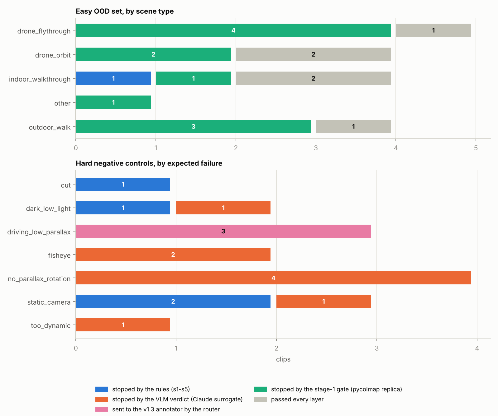
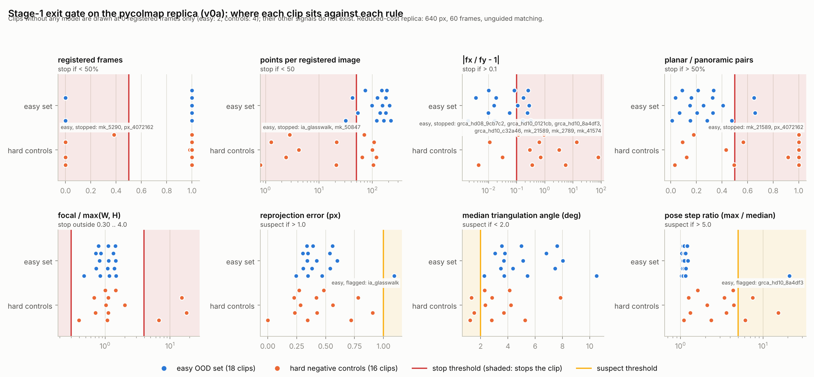
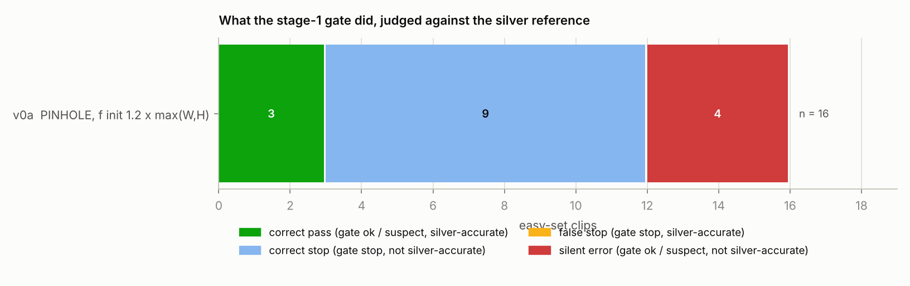
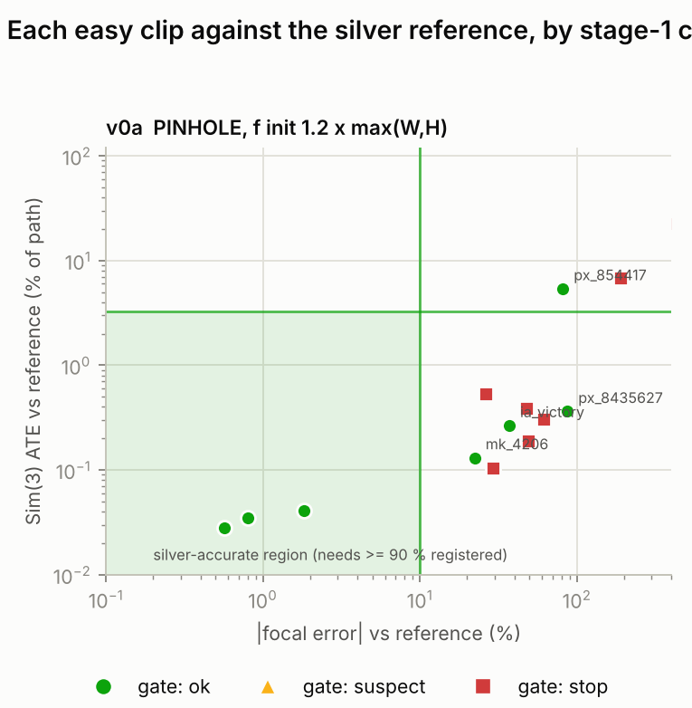

E15 · GLR 轨道 · 沙箱报告
# 前后端过滤 + GLRMap 打标，能放心批量跑吗

把 3DData_anno 的前端筛选（传统规则 + VLM）和后端质检接到 GLRMap 打标上，用 18 条简单网络视频和 16 条硬对照在没有 GPU 的沙箱里试跑。

- 2026-10-29
- 仅 CPU（4 核）
- 分支 `e15-glr-track`
- 第一阶段 = pycolmap 复刻，VLM = Claude 替身

**读结果前：** 沙箱里没有 GLRMap 代码、GPU，也连不上你的服务器。第一阶段是 pycolmap 的降本复刻（640 px、60 帧、顺序匹配），比真实 GLRMap 更苛刻；VLM 判官是 Claude 不是 Qwen3-VL-32B。下面是线索和已经接通的管线，不是 GLRMap 的验收。

## 结论 _(number first, then what it means)_

- **18 + 16** 条片段：简单网络视频 + 硬对照（5 条对照因许可证只在本地试过，不进 manifest）
- **17 / 18** 简单片段通过前端（规则 + VLM 替身）
- **16 / 16** 硬对照没能变成 GLR 标签（被规则、VLM、路由或关口挡住）
- **7 / 18** 简单片段通过第一阶段出口关口（复刻 v0a）
- **11 / 14** 有银参考的片段里，焦距与参考相差 > 10 %
- **177** 项自动测试通过（含与原脚本逐项对拍）

**1 · “简单”的网络视频，第一阶段并不容易过。** 复刻的第一阶段给出模型的 16 条里，7 条过关口；其余被 `fx_fy_mismatch`（fx 与 fy 差 > 10 %）、每图点数太少、平面对占比高或没出模型挡住。位姿本身大多是准的：与银参考比，11 / 14 条的 Sim(3) ATE ≤ 3.27 %。**2 · 主要风险是内参 K，不是轨迹。** 自由焦距的 PINHOLE 在前进镜头、远景航拍上焦距几乎不可观测：11 / 14 条的焦距与银参考差 > 10 %，其中 4 条还通过了关口（静默错误），v1c 的 K 容差（HFOV 13.2°，约 25 % 焦距）也不会拦。这和评估会话里的 KITTI / 无人机结论一致。**3 · 前端和关口是互补的两层。** 规则 + VLM 挡掉纯摇镜、静止、夜景、切镜、人群；开车类片段 VLM 判“可重建”，由路由送去 v1.3；第一阶段关口再兜住前端漏掉的退化（15 / 16 条对照被它 stop）。15 / 16 条对照被至少两层独立挡住；只靠一层的是 ctl_misc_14774（鱼眼，只有 VLM 拦住）。混入的 1 条淡水印（ia_telangana）规则和 VLM 都没看见。**4 · 管线接通了，并且按“查不出就拒绝”设计。** 路由 → 作业包 → worker（关口先于 RoMa / PDA）→ 收集 → 质检分级 → 合并 / 回退 v1.3，在真实片段上贯通；任何一环失败、缺证据、缺深度都变成拒绝，不会悄悄出标签。**5 · 没做、也做不了的。** 没有跑真实 GLRMap、RoMa、PDA、ViPE、Pi3X；证人质检只有接线测试。第二轮独立评审因预算停止。这些都在“下一步”里给了服务器上的执行清单。

## 你的三个要求，各做到哪一步 _(request → delivered → not done)_

| 要求 | 做了什么 | 没做到 |
|---|---|---|
| 1 · 按计划继续做 | Phase 0 里沙箱能做的部分：关口规则 + 回放工具、第一阶段复刻与消融、前端筛选在新片段上的回放；服务器上要做的部分写成带通过线 / 放弃线的 runbook。 | 离线回放要的服务器数据；真实 GLRMap 联调（沙箱没有）。 |
| 2 · 下载简单些的 OOD 视频再测 | 从 Mixkit、Pexels、Internet Archive、美国国家公园局 B-roll 找到并逐条核验了 18 条 DL3DV 难度的片段，另配 16 条硬对照；全部跑了前端筛选、第一阶段复刻、银参考。 | YouTube 在沙箱里被拦（没有绕过）；没有许可证干净的鱼眼对照；真实 GLRMap 没跑。 |
| 3 · 前后端过滤和打标结合 | `pipeline/run_batch_glr.sh`：原样复用 3DData_anno 的筛选与 v1.3 质检，中间插入路由、GLRMap worker（带第一阶段出口关口）、跨模型证人质检、T1/T2/T3 分级和回退 v1.3；现有脚本一个没改。 | 真实 GLRMap 命令行 / 输出布局是按文档推断的，第一次在服务器上跑要照核对清单。 |

## 管线 _(front filter → router → GLRMap stage 1 + gate → dense → back QC → merge)_

1. **前端筛选** 3DData_anno 原样：切镜、亮度模糊、OCR、光流、GeoCalib + VLM 判官，`decide.py` 出 pass / reject。
2. **路由** 只让“静态场景 + 真视差”进 GLRMap；动态、旋转为主、驾驶、具身走 v1.3。自适应抽帧 60–120 帧。
3. **GLRMap 第一阶段** COLMAP SIFT + 顺序匹配 + GLOMAP 全局建图。
4. **出口关口** 注册率、点数、fx/fy、平面对、重投影、三角化角、K 证人分歧。stop 就不跑 RoMa / PDA，回退 v1.3。
5. **稠密阶段** RoMa v2 + Pi3X 先验 + PDA 深度（SfM 尺度）。
6. **后端质检** v1c 三项（对 ViPE 的轨迹、对 DA3 的深度、K 与 GeoCalib/Pi3X/DA3 的分歧）+ 旗标；查不出来一律拒绝。
7. **分级与合并** T1 / T2 用 GLR 标签；T3 或失败回退 v1.3 标签（v1c 通过才算）；再不行就拒绝。

蓝框 = 本次新增；其余是 3DData_anno 现有代码。

## 片段集 _(18 easy + 16 hard negative controls)_

来源与许可：Mixkit（7 条简单 + 11 条对照，Mixkit 免费许可）、Pexels（4）、Internet Archive（3，CC0 / CC BY / CC BY-SA）、美国国家公园局 B-roll（4，公有领域）。每条 12 s、15 fps、不含音频；清单、sha256、许可证和下载地址在 `docs/experiments/E15_ood_manifest.json`，`tools/fetch_ood_set.py` 可按清单重建。

### 独立核验发现的问题

- **mk_3110** 当初按“横移滑轨、视差最好”选入，独立核验发现是纯摇镜（旋转模型残差 0.013×光流，三角化角 1.3°），已改作无视差对照。光流里的视差代理分不开摇镜和平移，所以另外加了旋转模型视差指数：纯摇镜 ≤ 0.02，18 条简单片段 ≥ 0.82。
- **ia_telangana** 带一条淡水印（不透明度约 0.2–0.3，占画面 0.5 %，全程固定），接触表分辨率下看不见；保留为“水印探针”。
- 39 条 Mixkit 记录的作者字段写成“无署名”是错的（页面标记里有贡献者链接），已按页面重取；CC0 的 ia_telangana 是上传者自述。
- 许可证干净的对照里没有**鱼眼**；5 条“仅限个人使用”的对照（含 2 条鱼眼）只在本地试过，不进 manifest，不展示画面。

### 简单片段

（缩略图和逐片段徽章见网页版 `GLR_E15_summary.html`；逐片段结果见下面的总表。）

### 硬对照

（缩略图和逐片段徽章见网页版 `GLR_E15_summary.html`；逐片段结果见下面的总表。）

缩略图是各片段第 90 帧；CC BY / CC BY-SA 的片段只列文字，避免带出署名 / 相同方式共享的义务。

## 前端筛选：规则 + VLM 替身 _(filter/s1–s5 unchanged on CPU · Claude as a labelled surrogate for the judge)_

规则阶段（切镜、亮度 / 模糊、OCR、光流、GeoCalib）用 `tools/filter_stage_cpu.py` 原样跑在 CPU 上，只换了设备。VLM 判官用两位独立的 Claude 评审，读匿名接触表，提示词和 JSON 模式与 `filter/vlm_run.py` 相同，结果标 `vlm_claude`。它不是 Qwen3-VL-32B，换成真模型前这一层的数字只作参考。

*每种场景 / 失败类型里，哪一层最先挡住片段（灰色 = 全部通过）。*

- VLM 两位评审在 34 条里 32 条 上给出相同的“可重建”结论。
- **OCR 阶段有个 int16 溢出**：文本框面积在框大于约 181×181 px 时算错，会少报大字幕（已记入 KNOWN_ISSUES 第 9 条，没有改原脚本，因为会改变已记录的分数）。另外“前进镜头 + 画面中央一排亮窗”会被当成静态文字（`static_text_area` 误报）。
- 开车类对照（3 条）VLM 判“可重建”：它们的拦截靠路由（`vlm_driving`）和第一阶段关口。

## 第一阶段出口关口 _(pycolmap replica of GLRMap stage 1 · 18 easy + 16 controls)_

*每条关口规则上各片段的位置。红线 = stop 阈值，阴影一侧会被拦；黄线 = suspect。点是复刻 v0a（640 px、60 帧）的信号。*

阈值在看到任何片段之前就定下，没有为这批数据调过。复刻比真实第一阶段苛刻（分辨率低、无引导匹配），所以“每图点数”“平面对占比”两项不能直接和评估会话的数字比；因这类信号被拦的片段会在 960 px 重跑再下结论。

| 变体 | 有银参考的片段 | 过关口（ok / suspect） | 与银参考一致 | 静默错误 | 误拦 | 焦距误差中位数 |
|---|---|---|---|---|---|---|
| v0a PINHOLE，初值 1.2×长边（复刻 GLRMap 默认） | 16 | 7 | 3 | 4 | 0 | 42 % |
| v0b 同上，换建图种子 | 16 | 7 | 3 | 4 | 0 | 42 % |
| v1sp SIMPLE_PINHOLE（fx = fy） | 16 | 13 | 3 | 10 | 0 | 32 % |
| v2prior GeoCalib 焦距作初值，仍优化 | 14 | 7 | 3 | 4 | 0 | 41 % |
| v3fixed GeoCalib 焦距固定 | 14 | 13 | 6 | 7 | 0 | 11 % |
| v0a 在 960 px（子集） | 3 | 2 | 0 | 2 | 0 | 113 % |

*以银参考为标准，关口做了什么：通过且准 / 拦对了 / 误拦 / 静默错误。*

**逐片段总表（34 行）**

| 片段 | 类型 | 视差指数 | 规则 | VLM | 关口 v0a | 关口标志 | f/W 复刻 | f/W 银参考 | 焦距差 % | ATE % | 结局 |
|---|---|---|---|---|---|---|---|---|---|---|---|
| mk_21589 | indoor_walkthrough | 1.89 | pass | pass | ✕stop | fx_fy_mismatch planar_or_panoramic_pairs | 0.79 | 1.54 | -49 | 0.19 | ·拦对了 |
| mk_2789 | drone_orbit | 6.25 | pass | pass | ✕stop | fx_fy_mismatch | 1.09 | 0.86 | 26 | 0.53 | ·拦对了 |
| mk_41574 | outdoor_walk | 6.78 | pass | pass | ✕stop | fx_fy_mismatch | 0.81 | 1.15 | -29 | 0.10 | ·拦对了 |
| mk_4206 | outdoor_walk | 1.98 | pass | pass | ✓ok | | 0.72 | 0.85 | -22 | 0.13 | ✕静默错误 |
| mk_43622 | drone_orbit | 0.82 | pass | pass | ✓ok | | 0.86 | 0.87 | -1 | 0.03 | ✓通过且准 |
| mk_50847 | outdoor_walk | 2.39 | pass | pass | ✕stop | points_per_image | 1.13 | 0.49 | | | ·无参考 |
| mk_5290 | other | 0.87 | pass | pass | ✕stop | no_model | | 0.89 | | | ·拦对了 |
| px_19834200 | indoor_walkthrough | 2.02 | text_overlay | pass | ✓ok | | 0.47 | 0.47 | -1 | 0.03 | ✓通过且准 |
| px_4072162 | drone_flythrough | 4.52 | pass | pass | ✕stop | no_model | | 0.36 | | | ·拦对了 |
| px_8435627 | drone_flythrough | 1.80 | pass | pass | ✓ok | | 1.46 | 0.78 | 87 | 0.36 | ✕静默错误 |
| px_854417 | indoor_walkthrough | 5.09 | pass | pass | ✓ok | | 0.84 | 0.46 | 82 | 5.38 | ✕静默错误 |
| ia_glasswalk | outdoor_walk | 1.18 | pass | pass | ✕stop | points_per_image reproj_gt_1px | 1.47 | 0.91 | 61 | 0.30 | ·拦对了 |
| ia_telangana | drone_orbit | 1.37 | pass | pass | ✓ok | | 0.72 | 0.73 | -2 | 0.04 | ✓通过且准 |
| ia_victory | indoor_walkthrough | 2.31 | pass | pass | ✓ok | | 1.38 | 1.01 | 37 | 0.26 | ✕静默错误 |
| gov_grca_hd08_9cb7c2 | drone_flythrough | 2.00 | pass | pass | ✕stop | fx_fy_mismatch focal_at_colmap_default | 1.16 | 1.04 | 48 | 0.38 | ·拦对了 |
| gov_grca_hd10_0121cb | drone_orbit | 1.13 | pass | pass | ✕stop | fx_fy_mismatch | 1.11 | 0.38 | 190 | 6.84 | ·拦对了 |
| gov_grca_hd10_8a4df3 | drone_flythrough | 1.24 | pass | pass | ✕stop | fx_fy_mismatch pose_step_outlier | 1.44 | 0.27 | 440 | 22.46 | ·拦对了 |
| gov_grca_hd10_c32a46 | drone_flythrough | 2.29 | pass | pass | ✕stop | fx_fy_mismatch | 1.33 | 2.87 | | | ·无参考 |
| ctl_crowd_4437 | too_dynamic | | pass | no_inaccurate | ✕stop | points_per_image fx_fy_mismatch | 1.03 | | | | |
| ctl_drive_42368 | driving_low_parallax | 5.82 | pass | pass | ✕stop | points_per_image hfov_out_of_range fx_fy_mismatch low_parallax | 17.83 | | | | |
| ctl_misc_3498 | cut | | cut | no_unreconstructable | ✕stop | registered_lt_half planar_or_panoramic_pairs | 0.71 | | | | |
| ctl_night_40640 | dark_low_light | 0.20 | dark | no_inaccurate | ✕stop | points_per_image fx_fy_mismatch planar_or_panoramic_pairs pose_step_outlier low_parallax | 1.45 | | | | |
| ctl_pan_4448 | no_parallax_rotation | 0.02 | pass | no_unreconstructable | ✕stop | points_per_image fx_fy_mismatch planar_or_panoramic_pairs pose_step_outlier | 1.12 | | | | |
| ctl_static_4283 | static_camera | | pass | no_unreconstructable | ✕stop | no_model | | | | | |
| ctl_drive_52454 | driving_low_parallax | 3.26 | pass | pass | ✕stop | points_per_image fx_fy_mismatch | 2.01 | | | | |
| ctl_night_40746 | dark_low_light | 0.46 | pass | no_inaccurate | ✕stop | no_model | | | | | |
| ctl_night_4451 | static_camera | | text_overlay | no_unreconstructable | ✕stop | no_model | | | | | |
| ctl_static_3129 | static_camera | | blur | no_unreconstructable | ✕stop | hfov_out_of_range fx_fy_mismatch planar_or_panoramic_pairs | 6.73 | | | | |
| mk_3110 | no_parallax_rotation | 0.01 | pass | no_unreconstructable | ✕stop | points_per_image fx_fy_mismatch planar_or_panoramic_pairs low_parallax | 1.00 | 1.21 | -36 | 4.69 | ·拦对了 |
| ctl_drive_45312 | driving_low_parallax | 0.21 | pass | pass | ✕stop | fx_fy_mismatch | 1.12 | | | | |
| ctl_misc_14774 | fisheye | | pass | no_inaccurate | ✓ok | | 0.68 | | | | |
| ctl_misc_45623 | fisheye | 0.03 | pass | no_unreconstructable | ✕stop | fx_fy_mismatch planar_or_panoramic_pairs | 0.40 | | | | |
| ctl_pan_45414 | no_parallax_rotation | 0.00 | pass | no_unreconstructable | ✕stop | planar_or_panoramic_pairs | 1.07 | | | | |
| ctl_pan_47821 | no_parallax_rotation | 0.06 | pass | no_unreconstructable | ✕stop | points_per_image hfov_out_of_range fx_fy_mismatch pose_step_outlier | 15.21 | | | | |

视差指数 = 旋转模型残差 / 光流（纯摇镜 ≤ 0.06，有真视差 ≥ 0.8）。焦距差取 fx、fy 中较差的一个。结局只在银参考成功时给出。

## 内参 K：焦距为什么不稳 _(the dominant failure on web clips)_

银参考 = 另一次 SfM（每 6 帧、穷举匹配、SIMPLE_RADIAL、增量建图），不是真值，所以这里先问“两次独立重建的焦距是否一致”，再看 GeoCalib 站谁。

*每个简单片段对银参考：焦距误差（横）与 ATE（纵）。绿框 = 预声明的“一致”区域；标记形状 = 关口裁决。*

- 航拍和前进镜头里焦距几乎不可观测：复刻的焦距常停在初值 1.2×长边附近，fx 与 fy 各自漂移，被 `fx_fy_mismatch` 拦下；或者通过关口但焦距偏差 20–80 %。
- 换建图种子（v0b）结果不变，焦距误差是确定的，重跑发现不了。把 GeoCalib 焦距当初值（v2prior，14 条）最后落回和 v0a 同样的解（静默错误 4），优化器丢掉了先验。把 GeoCalib 焦距固定（v3fixed）过关口 13 / 14，与银参考一致 6 / 14，焦距中位误差 11 %，是沙箱里最好的一种；但它的“一致”只是和另一次重建、一个单图先验一致。
- SIMPLE_PINHOLE（v1sp）把过关口的从 7 / 16 提到 13 / 16，静默错误从 4 升到 10：它关掉了 fx/fy 这个“焦距定不下来”的警报，焦距还是错的，所以不能单独当修法。
- 三方对照（复刻、银参考、GeoCalib，14 条，容差 10 %）：三者一致 2；只有两个一致的组合里，银参考 = GeoCalib 5 次，复刻 = 银参考 1 次，复刻 = GeoCalib 0 次；互不一致 6。自由焦距的复刻是三者里最不可靠的一个。这张表是事后分析，不进预声明的结局统计。
- 修法不在门槛上：评估会话的焦距扫描（E14）、K 先验初始化、固定 K、SIMPLE_PINHOLE，需要在服务器上用真实 GLRMap 做 Phase 0.2b 的消融，runbook 里写了通过线。

## 联调演示 _(route → worker (gate) → collect → QC → merge on real clips)_

在真实片段上走完阶段 a（路由 + 作业包）→ b（worker：第一阶段复刻 + 真关口 + 稠密替身）→ c（收集、质检分级、合并）。稠密深度用稀疏点插值替身，证人用银参考重建替身，v1.3 一侧没有标签，所以没有回退标签可用。

| 片段 | 路由 | 关口 | worker | v1c | kdis (°) | xdepth_k | 分级 | 最终 | 原因 |
|---|---|---|---|---|---|---|---|---|---|
| ia_telangana | glr | ok | complete | 0.76 | 6.3 | 0.15 | T2 | glr (T2) | |
| mk_43622 | glr | ok | complete | 1.60 | 1.6 | 0.31 | T3 | 拒绝 | glr:v1c_gt_1;v13:none |
| mk_4206 | glr | ok | complete | 0.88 | 10.8 | 0.17 | T2 | glr (T2) | |
| mk_41574 | glr | stop | stopped_at_gate | | | | T3 | 拒绝 | glr:glr_stopped_at_gate;s1_fx_fy_mismatch;v13:none |
| mk_21589 | glr | stop | stopped_at_gate | | | | T3 | 拒绝 | glr:glr_stopped_at_gate;s1_fx_fy_mismatch;s1_planar_or_panoramic_pairs;v13:none |
| ia_victory | glr | suspect | complete | 1.24 | 16.3 | 0.14 | T3 | 拒绝 | glr:v1c_gt_1;v13:none |
| px_19834200 | reject (filter) | | | | | | | 拒绝 | filter:text_overlay |

稠密深度和证人是替身（见限制），v1.3 一侧没有标签所以没有回退：这张表说明各段接得上、关口和质检规则按预期反应，不说明标签精度。v1c > 1 就拒绝；mk_43622 的 xdepth_k 来自两次不同的稀疏点插值（替身深度对替身证人），不是标签质量的结论。

## 工程与评审 _(what changed in the repo)_

- 新增（现有脚本一个没改）：`pipeline/{run_batch_glr.sh, glr_prepare.py, glr_worker.sh, glr_stage1_gate.py, glr_collect.py, glr_merge.py, glr_common.py}`、`configs/pipeline_glr_v0.yaml`、`tests/glr/`（177 项）、`tools/` 与 `evolution/E15_glr/` 的沙箱工具。
- **第一轮独立评审** （4 个视角，63 条原始发现：高 16 / 中 33 / 低 14），逐条由另一个代理复现，已复现的全部修复并写成测试。最重的几条：关口自己崩溃会被读成 suspect（放行）；合并时旧软链接不更新；没有 GLR 作业时阶段 c 崩溃；竖屏片段的焦距规则；模板里的引号 / 注入；taskset / timeout 没套住整个命令。
- 修复过程中自己又发现并修了：参考模型选错（`sparse/0` 不一定是最大的）、fx 与 fy 只比一个、参考失败时仍给结局。
- **第二轮评审（检查修复本身）因预算停止，没有结果。** 代替它的是更多的表驱动测试和变异检查。

## 限制：这些结论不能下 _(what this does not show)_

- 不能说“GLRMap 在简单网络视频上通过率是 X”。复刻是降本版（640 px、60 帧、顺序匹配、无引导）；真实 GLRMap 用全分辨率、约 100 帧、GPU SIFT。
- 不能说“前端 + VLM 的召回是 X”。VLM 是 Claude 替身，片段 34 条，样本小。
- 不能说“质检能抓住 GLR 的错”。证人质检只有接线测试，稠密深度和证人都是替身。
- 银参考是第二次 SfM，不是真值；K 的对错没有地面真值。

## 下一步 _(server-side Phase 0 and decisions)_

在服务器上按 `docs/GLR_PHASE0_RUNBOOK.md` 做（每步有命令、耗时、通过线 / 放弃线，阈值在看结果前固定）：

- **0.2 关口离线回放**：用已有的第一阶段输出回放关口，对标签算捕获率 / 误拦率（`tools/glr_gate_replay.py`）。
- **0.2b 内参策略消融**：同一份匹配库上跑 PINHOLE / SIMPLE_PINHOLE / 先验初值 / 固定焦距（`evolution/E15_glr/run_sweep.sh` 的配方）。
- **0.3 用真实 Qwen3-VL 重跑本页的片段集**，对照 Claude 替身的结论。
- **1 第一次真实 GLRMap 联调**：先 `glr_worker.sh JOB --dry-run`，按 `docs/GLR_INTEGRATION.md` §6 核对命令模板和深度文件布局。

### 需要你决定

- K 策略要不要作为第一阶段的默认（先验初始化 / 固定 / SIMPLE_PINHOLE），还是先做 E14 焦距扫描？
- GLR 路由是否只收“静态 + 真视差”的片段（现在的设计），还是先在 A 组有真值的片段上和 v1.3 并排跑？
- GLRMap 仓库的访问权限：沙箱里读不到，命令模板还是推断的。
代码与文档：[GLR_INTEGRATION.md](https://github.com/Xiaoxuxu994/3ddata_anno/blob/e15-glr-track/docs/GLR_INTEGRATION.md) · [Phase 0 runbook](https://github.com/Xiaoxuxu994/3ddata_anno/blob/e15-glr-track/docs/GLR_PHASE0_RUNBOOK.md) · [LOG.md（E15）](https://github.com/Xiaoxuxu994/3ddata_anno/blob/e15-glr-track/docs/experiments/LOG.md) · [片段清单](https://github.com/Xiaoxuxu994/3ddata_anno/blob/e15-glr-track/docs/experiments/E15_ood_manifest.json) · [沙箱脚本](https://github.com/Xiaoxuxu994/3ddata_anno/blob/e15-glr-track/evolution/E15_glr/README.md)。本页由 `evolution/E15_glr/build_report_page.py` 从结果文件生成。
